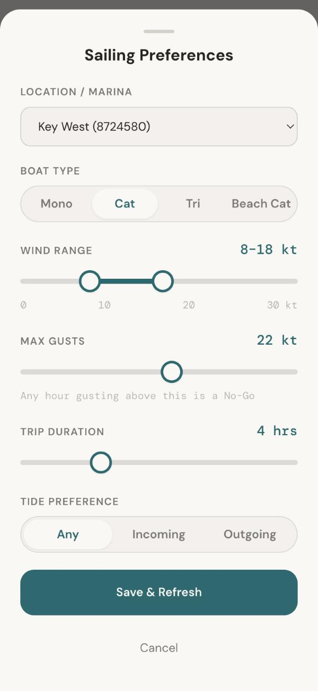
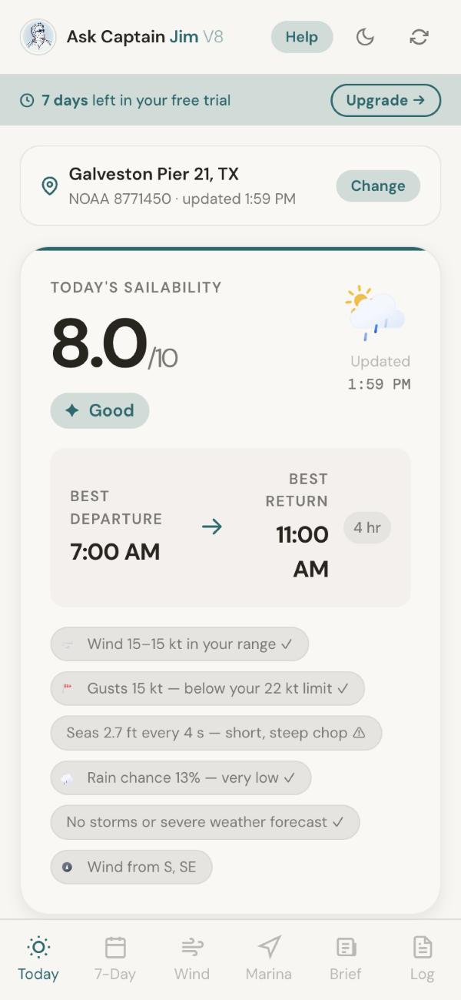
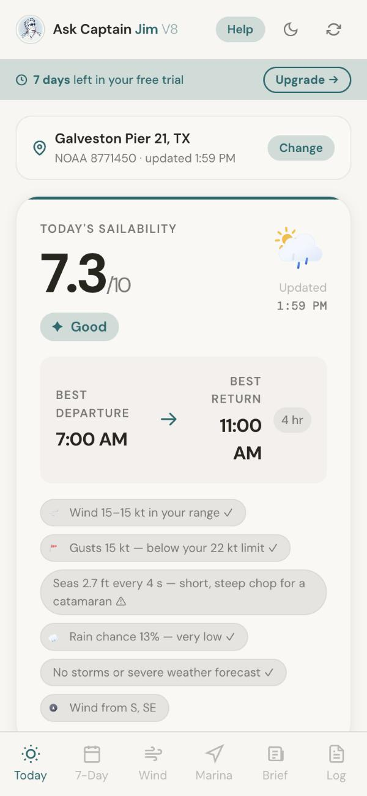
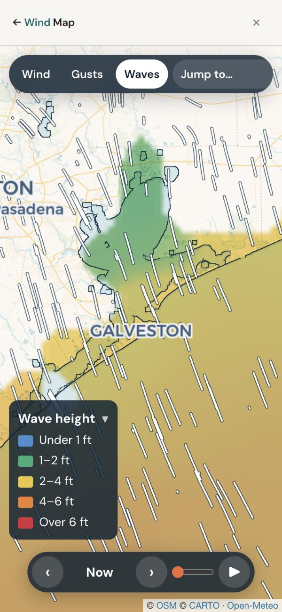
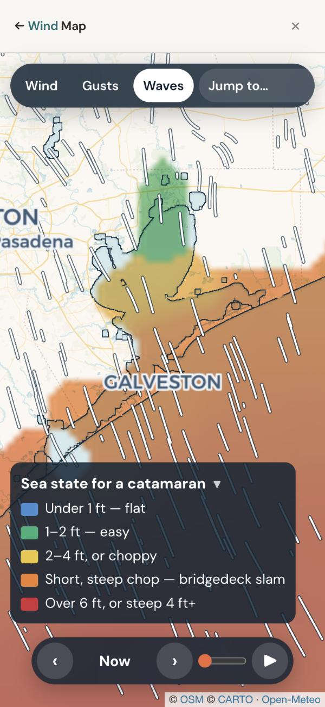
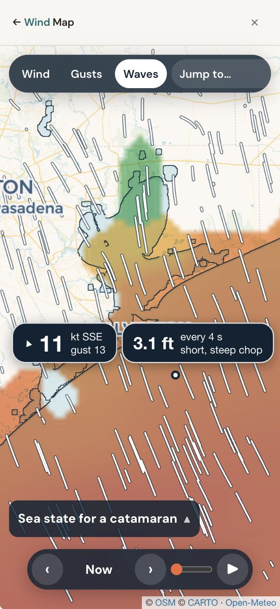
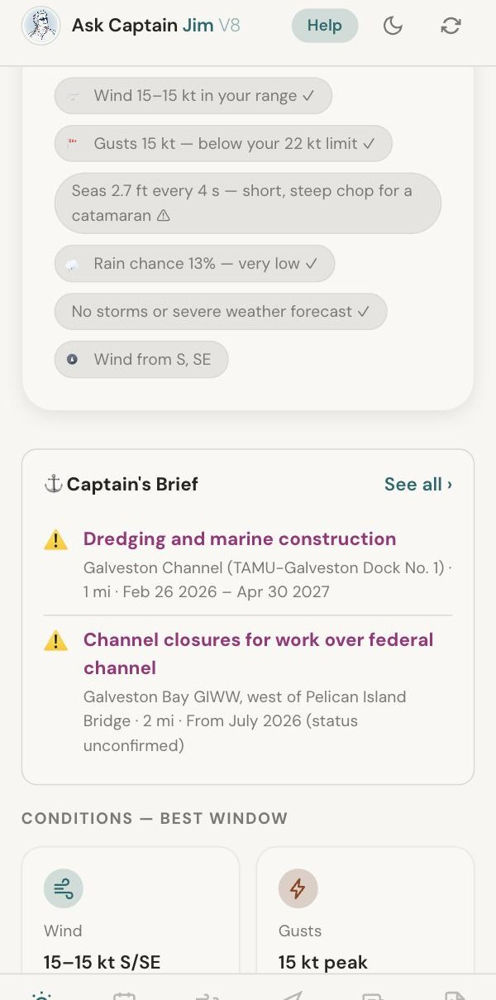
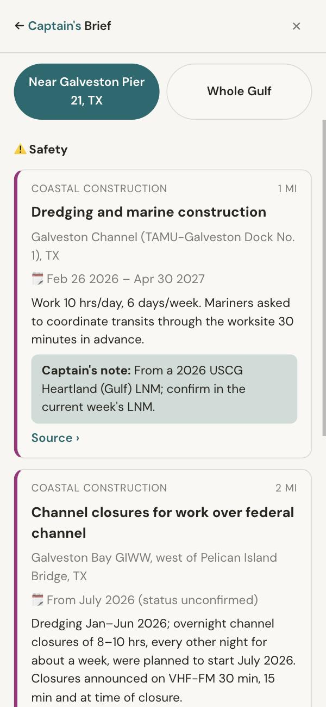

# Ask Captain Jim — What's New for Multihull Sailors

**Prepared for Tommy Clark, Windcraft Multihulls · October 2026 · askcaptainjim.com**

Tommy, you said Ask Captain Jim fits the "Average Joe," the family weekend sailor and the beginner-to-intermediate skipper. So everything below was built for exactly those customers, and especially for the ones on cats and tris. It's all live today. The screenshots are real, taken from the app on a phone this afternoon.

## 1. The app now knows what boat you sail

In Sailing Preferences, a new **Boat Type** setting: **Monohull, Catamaran, Trimaran or Beach Cat**. Pick one and the whole app reads the same forecast the way that boat experiences it.

**Why it matters:** a monohull heels and spills a gust, so the skipper feels it coming. A multihull stays flat and takes the full load. And a catamaran's bridgedeck pounds in short, steep chop that a monohull shrugs off. So for multihulls the app now:

- **Watches the gap between wind and gusts more closely.** A big gust spread lowers a multihull's score sooner and harder, and a reason tag says "Gusty for a catamaran."
- **Weighs choppy seas more heavily.** Wave height *and* how close together the waves come now count in the score.
- **Sets a no-go wind limit for each boat:** 26 kt for a monohull or cruising cat, 24 kt for a trimaran, 20 kt for a beach cat (which is also a no-go in 4 ft seas).

## 2. Same forecast, different boat: a real example from today

Galveston, this afternoon: 15 kt, with 2.7 ft seas coming every 4 seconds. A monohull scores **8.0**. A catamaran scores **7.3**, and the app tells the skipper why: *"short, steep chop for a catamaran."*

 

**What each hull type gets:**

- **Catamaran (Seawind and other cruising cats):** stricter about gusts; waves count 1.5 times as much; no-go above 26 kt.
- **Trimaran (Corsair, Dragonfly):** the same stricter gust handling; waves count 1.3 times as much; no-go above 24 kt.
- **Beach Cat:** the strictest of all; waves count twice as much; no-go above 20 kt or in 4 ft seas. Choosing it also suggests gentler limits (6–15 kt, 18 kt maximum gust).
- **Monohull:** the baseline the app has always used.

The same 3 ft of sea scores very differently by *period*: when the waves come 4 seconds apart a catamaran drops to 6.1, but in a gentle 9-second swell it holds at 7.6.

## 3. The Wind Map: see where the slam zone is

Tap **Wind** in the bottom bar for three days of wind, gusts and waves across the coast. It opens right on your marina. For a multihull, the **Waves** layer becomes **"Sea state for a catamaran"** (or trimaran, or beach cat), so short, steep chop shows in **orange: "bridgedeck slam."**

Here's the same Galveston water as a monohull and as a catamaran sees it. The monohull map shows a moderate "2–4 ft" sea in yellow. The catamaran map shows the same water in orange.

 

### Tap anywhere for instant details

On every layer (Wind, Gusts or Waves), **one tap on any spot on the water** shows that exact spot's wind and direction, gusts, wave height and how many seconds apart the waves are. Check the bay, the pass and offshore in three taps before leaving the dock.

- **Plays forward 72 hours.** Press ▶, or drag the slider to an hour: good for seeing when the chop lies down.
- **The color key folds away.** Tap it and it shrinks to its title (as above), so it doesn't cover the map. The app remembers this on each phone.
- **Colors follow each sailor's own limits:** green is their range, red is over their limit for their boat.

## 4. The Captain's Daily Brief, live today

Hand-checked news that affects boaters: bridge and channel work, Coast Guard rule changes, marina deals, boat shows, regattas and festivals. The top items near the sailor's marina appear right under the score, Safety first, and the **Brief** tab has the rest. In Galveston today, two Safety items show up within 2 miles.

 

## 5. Also in the app

- **Sailing Window score (0–10)** with the best departure and return times for the trip length you choose, and plain-English reasons.
- **Live data:** National Weather Service, NOAA tides from 35 stations, and the ECMWF model for the 7-day outlook, plus a commercial marine wave forecast.
- **7-Day Forecast** with a score for each day.
- **80+ Gulf marinas** with tap-to-call numbers, **restaurants within walking distance**, and **48 drawbridges** with VHF channels, clearances and schedules.
- **Cruiser's Log** with trip reports from other sailors, each checked by hand before it appears.
- **Weak-signal help:** if the cell signal drops offshore, the app keeps the last forecast up and walks the skipper through switching to the boat's Starlink or marina Wi-Fi.
- **Works on any phone**, nothing to install, Texas to the Florida Keys. 7-day free trial, then $5.99 a month or $49 a year.

## Try it in two minutes

1. Open **askcaptainjim.com** and tap **"Sailing Today? Ask Captain Jim."**
2. Tap **Edit** on Sailing Preferences, set **Boat Type** to Catamaran or Trimaran, and save.
3. Tap **Change** on the location bar and pick **Pensacola**.
4. Tap **Wind** at the bottom, then **Waves**, and tap a few spots on the bay and offshore.

## Two ways Windcraft could help

1. **Your numbers.** The multihull limits are careful starting points. We'd much rather use Windcraft's: the wind range, gust limit and "stay in" wind speed you'd give a new owner of a cruising cat, a performance tri and a beach cat. And does "2 ft or more, under 5 seconds apart" match what makes a cat pound?
2. **Free access for your customers.** We'd be glad to give Windcraft buyers, Seawind co-owners and anyone on your client list free access, presented as a welcome gift from Windcraft if you'd like. You could pass along this sheet or the link, and we'd take care of the rest.

**Russ Jamieson** · Rj & HRS Marketing · Ask Captain Jim · russjamieson@gmail.com · (770) 310-0606
